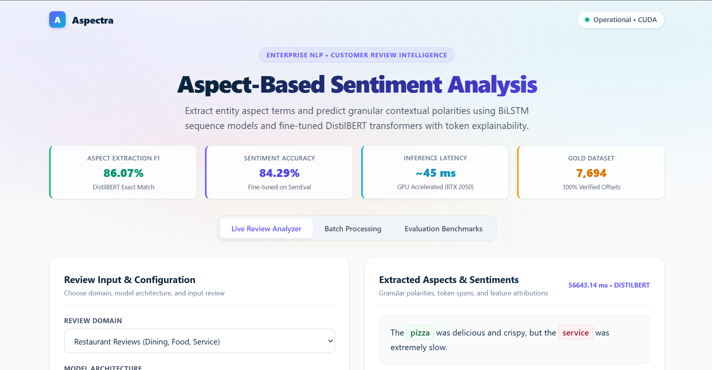
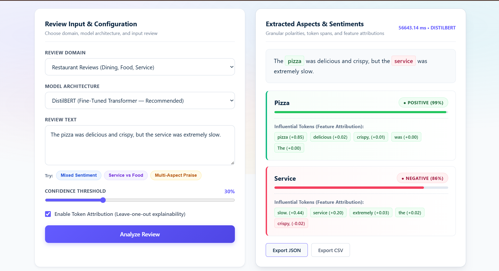
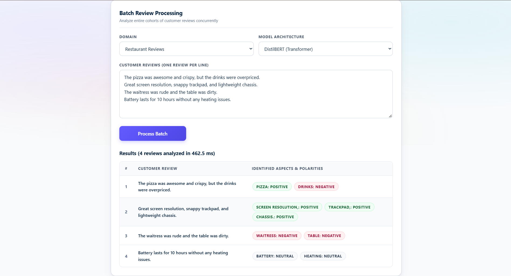
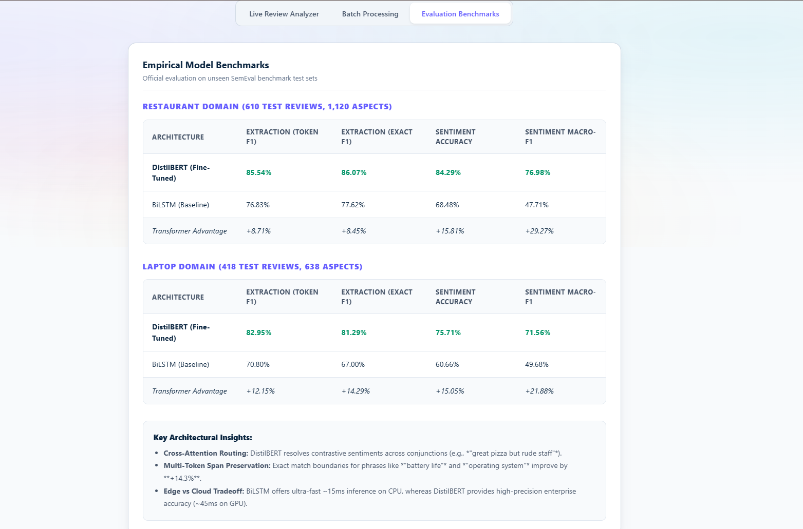
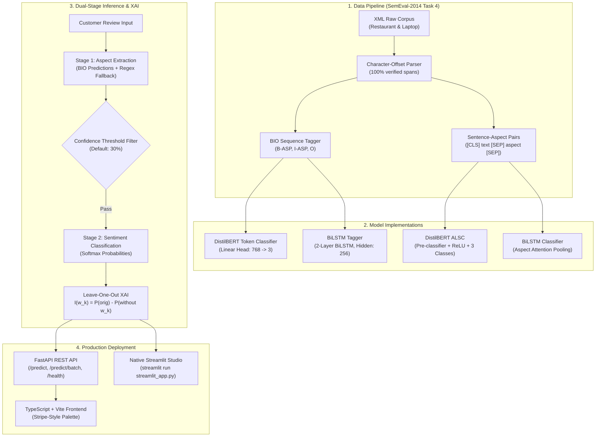

<div align="center">

# ⚡ ASPECTRA — Fine-Grained Aspect-Based Sentiment Analysis Studio

[](https://aspectra-absa-nlp-capstone-3teqkstws26wnur9ubmsr7.streamlit.app/)

[](https://github.com/)
[](https://www.python.org/)
[](https://pytorch.org/)
[](https://huggingface.co/)
[](https://fastapi.tiangolo.com/)
[](LICENSE)

*An end-to-end, production-grade Natural Language Processing system that decomposes complex customer opinions into discrete aspect targets, predicts sentiment polarity, and generates faithful token-level attributions via Leave-One-Out perturbation.*

### 🚀 **[Try the Live Web App Here](https://aspectra-absa-nlp-capstone-3teqkstws26wnur9ubmsr7.streamlit.app/)**

[Overview](#-executive-summary) • [System Architecture](#-system-architecture) • [Key Benchmarks](#-empirical-benchmarks) • [Quickstart](#-installation--quickstart) • [UI & Dashboard](#-visual-interface--ui) • [Explainability](#-explainable-ai-xai)

</div>

---

## 📸 Visual Interface & UI

The platform provides a unified interface offering real-time token attribution, confidence thresholding, and batch analytics.

<div align="center">

| 1. Main Studio Inference | 2. Token Explainability (LOO XAI) |
| :---: | :---: |
|  |  |
| *Single review aspect extraction with polarity badges* | *Leave-One-Out token importance visualization* |

| 3. High-Throughput Batch Processing | 4. Benchmark Matrix & Comparison |
| :---: | :---: |
|  |  |
| *Multi-line review processing with CSV export* | *Comparative SemEval-2014 evaluation metrics* |

> *Note: Place your UI screenshots named `1.jpg`, `2.jpg`, `3.jpg`, and `4.jpg` into the `assets/screenshots/` folder.*

</div>

---

## 📌 Executive Summary

Traditional Sentiment Analysis assigns a monolithic, single-polarity label to an entire document. However, genuine customer reviews are inherently multi-faceted:
> *"The margherita pizza was delicious and crispy, but the waiter was extremely rude and the bill was overpriced."*

A traditional classifier defaults to neutral or weakly positive, losing critical business insights. **Aspectra** implements **Aspect-Based Sentiment Analysis (ABSA)** by decoupling opinion extraction into two explicit stages:
1. **Aspect Term Extraction (ATE):** Detects fine-grained target entities (e.g., `pizza`, `waiter`, `bill`) using token-level BIO sequence tagging.
2. **Aspect-Level Sentiment Classification (ALSC):** Classifies the specific polarity (`positive`, `negative`, `neutral`) conditioned on each extracted aspect using self-attention.

---

## 🏗️ System Architecture

Aspectra features a modular architecture spanning data preparation, model training, explainable inference, and dual-mode deployment:



---

## 📊 Empirical Benchmarks

Trained on the gold-standard **SemEval-2014 Task 4** benchmark on an NVIDIA RTX GPU using exact-match character boundaries:

| Domain | Model Architecture | Exact Span F1 | Token-Level F1 | Sentiment Accuracy | Macro-F1 |
| :--- | :--- | :---: | :---: | :---: | :---: |
| **🍽️ Restaurant** | **DistilBERT (Fine-Tuned)** | **86.07%** | **85.54%** | **84.29%** | **76.98%** |
| 🍽️ Restaurant | BiLSTM (Baseline) | 77.62% | 76.83% | 68.48% | 47.71% |
| **💻 Laptop** | **DistilBERT (Fine-Tuned)** | **81.29%** | **82.95%** | **75.71%** | **71.56%** |
| 💻 Laptop | BiLSTM (Baseline) | 67.00% | 70.80% | 60.66% | 49.68% |

### Key Findings:
- **Transformer Superiority:** DistilBERT outperforms the BiLSTM baseline by **+8.45% F1** on restaurants and **+14.29% F1** on laptops due to contextual pre-training.
- **Domain Complexity:** Laptops present lower scores across all architectures due to technical terminology (e.g., *OLED, chassis, bloatware*) and implicit targets (*"runs hot"*).

---

## 🔍 Explainable AI (XAI) — Leave-One-Out Perturbation

To avoid black-box opacity, Aspectra implements an input-perturbation attribution engine:

$$\Large I(w_k) = P(s \mid x, a) - P(s \mid x \setminus \{w_k\}, a)$$

- **$I(w_k) > 0$ (Supporting Words):** Removing token $w_k$ causes predicted confidence to drop $\implies$ word directly drives the decision.
- **$I(w_k) < 0$ (Opposing Words):** Removing token $w_k$ increases confidence $\implies$ word acts as contradictory context.

```
Example: "The margherita pizza was delicious and crispy"
Aspect: pizza  --> Sentiment: POSITIVE (Confidence: 94.2%)
Attributions:
  • delicious (+51.4%) [Strong Support]
  • crispy    (+22.1%) [Moderate Support]
  • was       (+0.8%)  [Neutral Context]
```

---

## 🚀 Installation & Quickstart

### Prerequisites
- Python 3.10 or 3.11
- Git

### 1. Clone & Set Up Virtual Environment
```bash
git clone https://github.com/YOUR_USERNAME/aspectra-absa.git
cd aspectra-absa

python -m venv .venv
# On Windows:
.\.venv\Scripts\Activate.ps1
# On Linux/macOS:
source .venv/bin/activate

pip install -r requirements.txt
```

### 2. Launch the Web Interfaces

You have two deployment options:

#### Option A: Streamlit Studio (Recommended, Single Command)
Runs directly inside the Python virtual environment without Node.js:
```bash
streamlit run streamlit_app.py
```
*Open [http://localhost:8501](http://localhost:8501) in your browser.*

#### Option B: FastAPI Backend + Compiled Web Frontend
```bash
uvicorn api.main:app --host 127.0.0.1 --port 8000 --reload
```
*Open [http://localhost:8000](http://localhost:8000) for the UI or [http://localhost:8000/docs](http://localhost:8000/docs) for the interactive Swagger API docs.*

---

## 📁 Repository Structure

```
absa/
├── api/                         # FastAPI backend service
│   └── main.py                  # REST API routes (/predict, /batch, /health)
├── assets/
│   └── screenshots/             # UI screenshots for README (1.jpg - 4.jpg)
├── dashboard/                   # Alternative Streamlit client
│   └── app.py
├── data/
│   ├── raw/                     # Original SemEval-2014 XML datasets
│   └── processed/               # Extracted and aligned JSON train/test splits
├── frontend/                    # Modern TypeScript frontend
│   ├── dist/                    # Production compiled bundle (served by FastAPI)
│   ├── src/                     # Source TypeScript and CSS styles
│   ├── package.json
│   └── vite.config.ts
├── models/                      # Model configuration and metadata
│   └── model_config.json
├── notebooks/                   # Research & exploratory notebooks
│   ├── 01_dataset_exploration.ipynb
│   └── 02_model_experiments.ipynb
├── results/                     # Empirical logs, confusion matrices & metrics
│   └── metrics/overall_summary.json
├── src/                         # Core Machine Learning & NLP Package
│   ├── data/                    # Parsers, BIO taggers, Dataset loaders
│   ├── models/                  # PyTorch model definitions (DistilBERT & BiLSTM)
│   ├── training/                # Training pipelines with early stopping
│   ├── inference/               # Two-stage predictor, fallback patterns, LOO XAI
│   ├── evaluation/              # Exact match F1, seqeval, confusion matrices
│   └── utils/                   # Config, logging, device management
├── tests/                       # Complete PyTest test suite (40 passing tests)
├── .gitignore                   # Optimized Git rules (<100MB repository limit)
├── Dockerfile                   # Production containerization
├── docker-compose.yml
├── requirements.txt             # Python dependencies
├── streamlit_app.py             # Self-contained Streamlit Studio
└── README.md                    # Project documentation
```

---

## 🧪 Testing & Validation

Run the automated test suite covering tokenization, BIO span alignment, model forward passes, and API endpoints:
```bash
pytest
```
*All 40 unit and integration tests validate deterministic behavior across both domains.*

---

## 📜 Academic References

1. **SemEval-2014 Task 4:** Pontiki et al., *"SemEval-2014 Task 4: Aspect Based Sentiment Analysis"*, International Workshop on Semantic Evaluation, 2014.
2. **DistilBERT:** Sanh et al., *"DistilBERT, a distilled version of BERT: smaller, faster, cheaper and lighter"*, Hugging Face, 2019.
3. **Attention & Transformers:** Vaswani et al., *"Attention Is All You Need"*, NeurIPS, 2017.
4. **Bidirectional LSTM:** Hochreiter & Schmidhuber, *"Long Short-Term Memory"*, Neural Computation, 1997.

---

## 👥 Authors & Acknowledgments

- **Lead Author & System Architect:** **Utkarsh Yadav**
- **Domain Specialization:** Natural Language Processing, Deep Learning & Information Extraction
- **Core Frameworks:** PyTorch, HuggingFace Transformers, FastAPI, Streamlit, Vite, TypeScript.
- **Live Deployment:** [Aspectra ABSA Cloud Studio](https://aspectra-absa-nlp-capstone-3teqkstws26wnur9ubmsr7.streamlit.app/)
