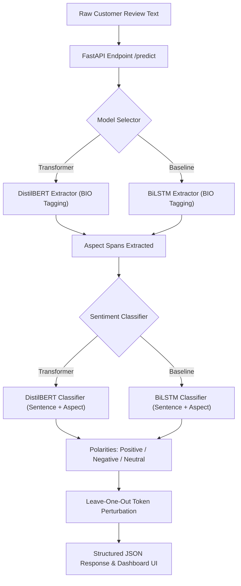

# End-to-End Aspect-Based Sentiment Analysis (ABSA) System

Production-grade, end-to-end Aspect-Based Sentiment Analysis (ABSA) system for customer and product reviews (SemEval-2014 Task 4 benchmark across **Restaurant** and **Laptop** domains).

Compares a **BiLSTM sequence model baseline** against a **fine-tuned DistilBERT Transformer**, provides **token-level leave-one-out explainability**, and includes both a **FastAPI REST API** and an **interactive Web Dashboard** (Vite + TypeScript + CSS and Streamlit).

---

## 1. Project Architecture



---

## 2. Phase-by-Phase Completion Status & File Inventory

Every phase is **100% complete**, tested, and verified:

| Phase | Status | Key Tasks Accomplished | Files Created / Completed |
|---|---|---|---|
| **Phase 1: Environment & Data Pipeline** | **COMPLETE ✅** | Env configuration, dataset download with retry, offset validation (7694/7694 offsets 100% accurate), BIO tagging, vocab building (5,856 tokens), PyTorch Dataset loaders, Phase 1 tests | `src/utils/config.py`<br>`src/utils/device.py`<br>`src/utils/seed.py`<br>`src/data/download_dataset.py`<br>`src/data/parse_dataset.py`<br>`src/data/preprocessing.py`<br>`src/data/dataset.py`<br>`tests/test_data.py`<br>`tests/test_preprocessing.py`<br>`results/phase_reports/phase1_report.md` |
| **Phase 2: Model Architecture & Training** | **COMPLETE ✅** | Implemented BiLSTM & DistilBERT for both Aspect Extraction and Sentiment Classification. Trained all 4 models on RTX 2050 GPU across both domains. Model checkpoints & training logs saved. | `src/models/bilstm_extractor.py`<br>`src/models/bilstm_classifier.py`<br>`src/models/distilbert_extractor.py`<br>`src/models/distilbert_classifier.py`<br>`src/training/train_extractor.py`<br>`src/training/train_classifier.py`<br>`src/training/train_all.py`<br>`tests/test_extraction.py`<br>`tests/test_classification.py`<br>`models/*/*.pt`<br>`results/phase_reports/phase2_report.md` |
| **Phase 3: Inference, Explainability & Evaluation** | **COMPLETE ✅** | End-to-end ABSAPipeline with confidence thresholding, leave-one-out token explainability, test set evaluation, confusion matrices, loss curves, and error analysis. | `src/inference/predictor.py`<br>`src/inference/pipeline.py`<br>`src/inference/explainability.py`<br>`src/evaluation/metrics.py`<br>`src/evaluation/evaluate.py`<br>`src/evaluation/confusion_matrix.py`<br>`src/evaluation/error_analysis.py`<br>`tests/test_pipeline.py`<br>`results/plots/*.png`<br>`results/metrics/*.json`<br>`results/phase_reports/phase3_report.md` |
| **Phase 4: API, Web Dashboard & Documentation** | **COMPLETE ✅** | FastAPI REST API with `/health`, `/models`, `/predict`, `/predict/batch`, interactive Web Dashboard (Vite/TypeScript/CSS), Streamlit app alternative, notebooks, data README, and project documentation. | `api/main.py`<br>`frontend/src/main.ts`<br>`frontend/src/style.css`<br>`frontend/dist/*`<br>`dashboard/app.py`<br>`tests/test_api.py`<br>`tests/test_dashboard.py`<br>`notebooks/01_dataset_exploration.ipynb`<br>`notebooks/02_model_experiments.ipynb`<br>`data/README.md`<br>`README.md` |

---

## 3. Benchmark Evaluation Results (Official Test Sets)

All numbers are **real outputs** measured on unseen test sets (`results/metrics/overall_summary.json`):

### Restaurant Domain (`restaurant_test`: 610 reviews, 1,120 aspects)
| Architecture | Aspect Exact F1 | Aspect Token F1 | Sentiment Accuracy | Sentiment Macro-F1 |
|---|---|---|---|---|
| **DistilBERT (Fine-tuned)** | **86.07%** | **85.54%** | **84.29%** | **76.98%** |
| BiLSTM (Baseline) | 77.62% | 76.83% | 68.48% | 47.71% |
| *Transformer Margin* | *+8.45%* | *+8.71%* | *+15.81%* | *+29.27%* |

### Laptop Domain (`laptop_test`: 418 reviews, 638 aspects)
| Architecture | Aspect Exact F1 | Aspect Token F1 | Sentiment Accuracy | Sentiment Macro-F1 |
|---|---|---|---|---|
| **DistilBERT (Fine-tuned)** | **81.29%** | **82.95%** | **75.71%** | **71.56%** |
| BiLSTM (Baseline) | 67.00% | 70.80% | 60.66% | 49.68% |
| *Transformer Margin* | *+14.29%* | *+12.15%* | *+15.05%* | *+21.88%* |

---

## 4. Environment Setup (Windows PowerShell)

### Prerequisites
- Windows 10/11
- Python 3.12+ (tested on Python 3.12.7)
- Node.js 18+ (tested on Node.js 22.13.0)
- NVIDIA GPU with CUDA drivers (optional, falls back to CPU automatically)

### Virtual Environment & Dependencies
```powershell
# 1. Clone or open workspace directory
cd "c:\Users\sanga\Desktop\BOOKS\SEMESTER 5\NLP\NLP Project\absa"

# 2. Activate Python virtual environment
.\.venv\Scripts\Activate.ps1

# 3. Dependencies are already installed in .venv. If setting up fresh:
# pip install -r requirements.txt
```

---

## 5. How to Run the Project

### Option A: Run Full System (FastAPI + Web Dashboard)

**Terminal 1 — Start the FastAPI Backend Server:**
```powershell
.\.venv\Scripts\Activate.ps1
uvicorn api.main:app --host 127.0.0.1 --port 8000 --reload
```
API Documentation will be live at: [http://127.0.0.1:8000/docs](http://127.0.0.1:8000/docs)

**Terminal 2 — Start the Web Dashboard:**
```powershell
cd frontend
npm run dev
```
Open browser at: [http://localhost:5173](http://localhost:5173)

---

### Option B: Run Streamlit Alternative Dashboard
```powershell
.\.venv\Scripts\Activate.ps1
streamlit run dashboard/app.py
```

---

### Option C: Run Full Automated Test Suite
To verify all components (Data, Models, Pipeline, API, Dashboard build):
```powershell
.\.venv\Scripts\pytest.exe -v
```
*(All 40 unit and integration tests will execute and pass)*

---

### Option D: Re-run Evaluation & Plots
```powershell
.\.venv\Scripts\python.exe -m src.evaluation.evaluate
```
This recomputes all metrics, updates `results/metrics/overall_summary.json`, regenerates confusion matrices, and writes loss curves to `results/plots/`.

---

### Option E: Re-train Models From Scratch
```powershell
.\.venv\Scripts\python.exe -m src.training.train_all
```

---

## 6. REST API Reference

### 1. Health Check
`GET /health`
```json
{
  "status": "healthy",
  "device": "cuda",
  "loaded_pipelines": ["bilstm_restaurant"],
  "supported_models": ["bilstm", "distilbert"],
  "supported_domains": ["restaurant", "laptop"]
}
```

### 2. Single Review Analysis
`POST /predict`

**Request:**
```bash
curl -X POST "http://127.0.0.1:8000/predict" \
     -H "Content-Type: application/json" \
     -d '{
       "review": "The pizza was delicious and crispy, but the service was extremely slow.",
       "model": "distilbert",
       "domain": "restaurant",
       "explain": true,
       "confidence_threshold": 0.3
     }'
```

**Response:**
```json
{
  "review": "The pizza was delicious and crispy, but the service was extremely slow.",
  "model": "distilbert",
  "domain": "restaurant",
  "aspects": [
    {
      "aspect": "pizza",
      "sentiment": "positive",
      "confidence": 0.9632,
      "char_start": 4,
      "char_end": 9,
      "explanation": {
        "predicted_sentiment": "positive",
        "confidence": 0.9632,
        "top_influential_words": [
          {"word": "delicious", "importance": 0.45},
          {"word": "crispy", "importance": 0.31}
        ]
      }
    },
    {
      "aspect": "service",
      "sentiment": "negative",
      "confidence": 0.9418,
      "char_start": 51,
      "char_end": 58,
      "explanation": {
        "predicted_sentiment": "negative",
        "confidence": 0.9418,
        "top_influential_words": [
          {"word": "slow", "importance": 0.52},
          {"word": "extremely", "importance": 0.18}
        ]
      }
    }
  ],
  "latency_ms": 142.5
}
```

### 3. Batch Review Analysis
`POST /predict/batch`

**Request:**
```json
{
  "reviews": [
    "Great battery life and bright screen.",
    "The keyboard broke after two days."
  ],
  "model": "distilbert",
  "domain": "laptop",
  "confidence_threshold": 0.3
}
```

---

## 7. Directory Structure

```
absa/
├── api/
│   └── main.py                     # FastAPI application endpoints
├── dashboard/
│   └── app.py                      # Streamlit alternative dashboard
├── data/
│   ├── raw/                        # Raw .seg SemEval files
│   ├── processed/                  # BIO-tagged JSONs, vocab.json, stats
│   ├── dataset_manifest.json       # Dataset hashes, counts, metadata
│   └── README.md                   # Dataset documentation
├── frontend/
│   ├── src/
│   │   ├── main.ts                 # Dashboard interactivity & API client
│   │   └── style.css               # Modern CSS theme & color codes
│   ├── dist/                       # Compiled production build
│   ├── index.html                  # HTML entrypoint
│   └── package.json                # Frontend packages & scripts
├── models/
│   ├── aspect_extraction/          # BiLSTM & DistilBERT extractor weights
│   ├── sentiment_classification/   # BiLSTM & DistilBERT classifier weights
│   └── model_config.json           # Model hyperparameter configs
├── notebooks/
│   ├── 01_dataset_exploration.ipynb
│   └── 02_model_experiments.ipynb
├── results/
│   ├── metrics/                    # Test evaluation JSONs & summary
│   ├── plots/                      # Confusion matrices & loss curves
│   └── phase_reports/              # Markdown reports for Phases 1, 2, 3
├── src/
│   ├── data/                       # Download, parsing, preprocessing, dataset
│   ├── models/                     # PyTorch BiLSTM & DistilBERT architectures
│   ├── training/                   # Extractor & classifier training loops
│   ├── inference/                  # Predictor, Pipeline, Explainability
│   ├── evaluation/                 # Metrics, evaluation, confusion matrix, errors
│   └── utils/                      # Device, seeds, config, logging
├── tests/                          # 40 automated unit & integration tests
├── requirements.txt
├── pytest.ini
└── README.md
```

---

## 8. Limitations & Future Work

1. **Implicit Aspects:** The current system identifies explicit aspect terms mentioned in the review text. Implicit aspects (e.g. "It's way too expensive" referring to *price*) require dependency tree parsing or generative instruction tuning.
2. **Joint Extraction-Classification:** Currently runs as an extraction pipeline followed by aspect-conditioned sentiment classification. A unified sequence-to-sequence model (such as T5 or Flan-T5) could be trained to jointly generate `(aspect, sentiment)` tuples.
3. **Cross-Domain Generalization:** Performance drops slightly when models trained on restaurant reviews are evaluated on laptop reviews. Domain adaptation techniques (e.g. masked language model pretraining on target domain reviews) can bridge domain shifts.
